# httpscope
📡 See where every millisecond of an HTTP request goes. ⏱️ DNS, connect, TLS, first byte and download as a waterfall, with median and p95 over many runs. Pure Python, zero dependencies. ⚡
